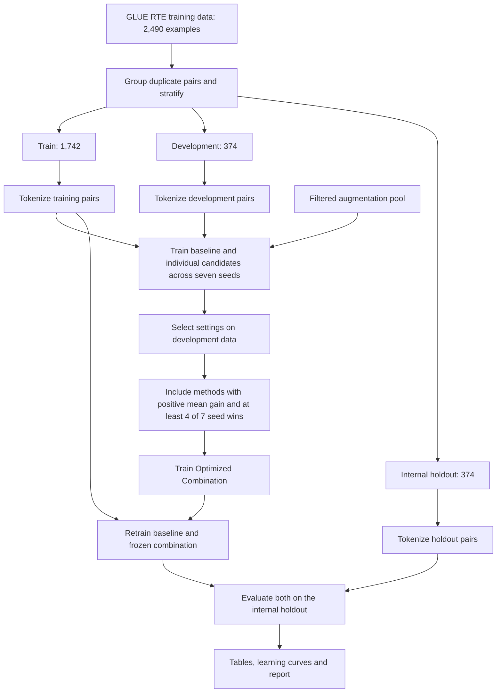

# DeBERTa-v3 Regularization on RTE

This study compares regularization methods for DeBERTa-v3-base on GLUE RTE over 12 epochs and seven seeds.

## Study protocol

- Settings: learning rate `3e-5`, batch size 32, weight decay `0.01`.
- Seeds: `123`, `456`, `789`, `1011`, `201765793`, `1801564980`, `1323889826`.
- Each method's value is selected by mean final development accuracy, with ties broken by lower development loss and then smaller value. A method enters the Optimized Combination when its mean paired gain is positive and at least four seeds beat baseline.
- The selected combination uses label smoothing `0.1`, Mixup `0.2`, R-Drop `0.1` and LLRD decay `0.8`.
- The internal holdout was examined in prior work, so its results are exploratory, not an independent test. Official RTE validation is not used in this comparison.

On development, the Optimized Combination averaged 86.40% accuracy versus 84.19% for baseline. On the exploratory internal holdout, it averaged 84.64% versus 80.33%, a mean paired gain of 4.32 percentage points; all seven seeds improved.

## Study pipeline



All pairs are truncated to 128 tokens. Augmentation and NEFTune did not meet the inclusion rule.

| Data partition | Examples | Purpose |
|---|---:|---|
| Internal training | 1,742 | Fit the model; augmentation is added here only |
| Internal development | 374 | Compare candidates and select the combination |
| Internal holdout | 374 | Compare the frozen baseline and combination |
| Official RTE validation | 277 | Cached separately; not used in this comparison |

### Published internal holdout results

| Seed | Baseline accuracy | Optimized Combination | Paired gain (percentage points) |
|---|---:|---:|---:|
| 123 | 77.27% | 85.03% | +7.75 |
| 456 | 79.41% | 83.69% | +4.28 |
| 789 | 77.01% | 84.49% | +7.49 |
| 1011 | 83.16% | 85.03% | +1.87 |
| 201765793 | 83.42% | 84.76% | +1.34 |
| 1801564980 | 81.82% | 85.83% | +4.01 |
| 1323889826 | 80.21% | 83.69% | +3.48 |
| Mean | 80.33% | 84.64% | +4.32 |

Gains are computed from unrounded accuracies; subtracting the displayed percentages can differ by 0.01 points.

## Repository layout

```text
configs/       Training and data configuration
docs/          Data protocol
src/regbench/  Data preparation, model training and regularization
scripts/       Study, held-out evaluation and Slurm scripts
tests/         Training and regularization tests
outputs/       Final study results, augmentation pool and report
```

- Report: `outputs/overfitting_study/report/combined_report.pdf`
- Candidate runs and selection: `outputs/regularization_selection_curves/`
- Holdout results: `outputs/heldout_evaluation/`

The saved run records and filtered augmentation pool support reproduction of the published analysis. Caches, logs and checkpoints are ignored by Git.

## Setup and execution

### Requirements

- Python 3.10 or newer and `pip`. The reported study used Python 3.12.
- Training and holdout evaluation require an NVIDIA GPU, compatible driver and CUDA-enabled PyTorch. The study used an A40, PyTorch 2.11 and CUDA 12.8. Minimum GPU memory is unverified; CPU-only training is unsupported.
- First-time downloads require internet access. Augmentation candidates require `outputs/augmentation/filtered.jsonl`.
- Saved runs are needed to regenerate published figures and tables. Tectonic or another suitable LaTeX installation is needed to rebuild the PDF. Slurm is optional.

The Python dependencies are PyTorch, Transformers, Datasets, SentencePiece, tiktoken, protobuf, NumPy, Matplotlib and PyYAML. They are declared in `pyproject.toml`; the optional `dev` extra adds pytest. Versions are not fully pinned, so a different environment may produce different results.

### Step 1: Install

From the project root, create and activate a virtual environment, then install a PyTorch build compatible with your GPU and driver using the instructions at [pytorch.org](https://pytorch.org/get-started/locally/). Install the project and run its tests:

```bash
python3 -m venv .venv
source .venv/bin/activate
# Install the appropriate PyTorch build first; see pytorch.org/get-started/locally/.
python -m pip install -e '.[dev]'
python -m pytest -q
```

The `-e` option installs the project in editable mode, so source changes take effect without reinstalling. The `.[dev]` argument means the project in the current directory plus its development extra, pytest. For installation without pytest, use `python -m pip install -e .` instead. On Windows, activate the environment with `.venv\Scripts\activate`.

### Step 2: Hugging Face access and downloads

The study uses [GLUE RTE](https://huggingface.co/datasets/nyu-mll/glue) and [DeBERTa-v3-base](https://huggingface.co/microsoft/deberta-v3-base). These public resources can normally be downloaded without a token; authentication can help with rate limits, and private or gated resources require appropriate access. If authentication is needed:

1. Create a Hugging Face account and a read-only or appropriately scoped token at [Access Tokens](https://huggingface.co/settings/tokens). For gated resources, also request access on their model or dataset page if required.
2. With the environment activated, run the following and enter the token directly at the private terminal prompt:

	```bash
	python -c "from huggingface_hub import login; login()"
	```

Keep tokens out of code, commands, job scripts and logs. Hugging Face stores credentials under `HF_HOME` by default; keep that directory private and follow your cluster's secret policy.

The default Hugging Face cache is `~/.cache/huggingface`. Set `HF_HOME` before login or download to use a private location accessible to compute nodes. The separate processed-data cache uses `REGBENCH_DATA`.

To download the dataset and tokenizer and create the processed split, run from the project root with the environment activated:

```bash
regbench prepare --config configs/default.yaml
python -m json.tool data_cache/v2_nyu-mll_glue_rte_microsoft_deberta-v3-base_L128_split70-15-15_seed13/split_manifest.json
```

Check the manifest for 1,742 training, 374 validation and 374 internal holdout rows. It calls the internal holdout `test` and records a legacy official-validation final-test designation; this study evaluates the internal holdout instead. Split code is in `src/regbench/data.py`; settings are in `configs/default.yaml`.

The generated manifest contains source row indices but is not included in the repository. Sharing the manifest and its Hugging Face dataset revision would allow the split to be reconstructed without redistributing the dataset text. The preparation script currently computes the split rather than loading indices from a shared manifest. Matching the split does not guarantee identical training results.

If `REGBENCH_DATA` is set, inspect `split_manifest.json` under the cache path printed by preparation. Existing caches are reused. The study scripts also prepare missing data automatically; on Slurm, the cache must be accessible to compute nodes.

The preprocessing is:

1. Read the RTE premise (`sentence1`), hypothesis (`sentence2`) and label (`0` for entailment, `1` for not-entailment). Group identical text pairs, even if their labels conflict, so duplicates cannot cross splits; all source rows are retained.
2. Stratify groups by label into training, development and internal holdout partitions. The second split uses seed 14; the configured first split uses seed 13. Grouping determines the realized row counts.
3. Tokenize each premise-hypothesis pair with the DeBERTa tokenizer, truncate to a maximum of 128 tokens and retain the original text for augmentation and audit. No additional text normalization is applied.
4. During batching, pad token IDs and attention masks to the longest sequence in that batch. The separately cached official validation data is not used for this study's held-out comparison.

The preparation command downloads the tokenizer, not the model weights. Training downloads those weights automatically on first use. To download and check the same model beforehand on a machine with network access, run:

```bash
python - <<'PY'
from transformers import AutoModelForSequenceClassification, AutoTokenizer

model_name = "microsoft/deberta-v3-base"
AutoTokenizer.from_pretrained(model_name)
AutoModelForSequenceClassification.from_pretrained(model_name, num_labels=2)
print("Tokenizer and model loaded; pretrained files are cached.")
PY
```

This command runs on CPU and needs enough RAM and disk space for the model. A warning that the classification head is newly initialized is expected for a pretrained base model. The actual training runs initialize and fine-tune their own classification heads. If regenerating augmentation, `google/flan-t5-large` is downloaded separately when the augmentation command runs.

### Step 3: Check the augmentation input

Confirm `outputs/augmentation/filtered.jsonl` is present. The study loads this existing pool; it does not generate it during the candidate run. It contains FLAN-T5-generated training examples filtered by a baseline classifier at confidence 0.85. Only training data is augmented. The requested ratios are 0.25, 0.50 and 1.00; the number appended is capped by the number of available filtered examples. See `src/regbench/data_aug.py` for generation, filtering and sampling.

To generate a **new** pool instead of using the supplied one, run the following from the project root in an environment with model-download access and suitable GPU resources:

```bash
regbench baseline --config configs/default.yaml --out outputs/new_augmentation
regbench augment --config configs/default.yaml --out outputs/new_augmentation
```

These commands train a teacher, then generate and filter examples into `outputs/new_augmentation/augmentation/filtered.jsonl`. To use that pool, set `augmentation_file` in `configs/default.yaml` to its path. It may not reproduce the published results; preserve the supplied pool. On Slurm, run these commands in a GPU allocation: the study's batch scripts do not submit them.

The seven-seed study compares the following candidate values:

| Method | Candidates | Selected value | In combination? |
|---|---|---|---|
| Augmentation ratio | 0.25, 0.50, 1.00 | 0.50 | No |
| Label smoothing epsilon | 0.05, 0.10, 0.15 | 0.10 | Yes |
| Mixup alpha | 0.1, 0.2, 0.4 | 0.2 | Yes |
| NEFTune alpha | 5, 10, 15 | 15 | No |
| R-Drop coefficient | 0.1, 0.5, 1.0 | 0.1 | Yes |
| LLRD decay | 0.8, 0.9, 0.95 | 0.8 | Yes |

The candidate grid, seven seeds, 12 epochs and learning rate `3e-5` are fixed in `scripts/run_regularization_curve_study.py`; the generic YAML grid does not control this study. The held-out script also fixes its seeds, epochs and learning rate.

**For a fresh experiment:** Work in a separate copy and back up the published results. The script can reuse old baseline and R-Drop records without checking the current dataset, as well as other completed runs. To prevent mixing results, move these directories out of the copy before training:

- `outputs/regularization_selection_curves/`
- `outputs/regularization_curve_study/`
- `outputs/heldout_evaluation/`
- `outputs/overfitting_study/runs/`

Retain `outputs/augmentation/filtered.jsonl` and `outputs/overfitting_study/report/`. The scripts recreate the run directories. Changes to the data, pool or code may change the results.

### Step 4A: Run without Slurm

1. On a machine with a working CUDA GPU, check that PyTorch can see it:

	```bash
	python -c "import torch; print('CUDA available:', torch.cuda.is_available())"
	```

2. From the project root, run candidate selection and combination training:

	```bash
	python scripts/run_regularization_curve_study.py
	```

3. Check that `outputs/regularization_selection_curves/status.json` says `completed` and inspect `selection.json` in the same directory. Then run the held-out comparison:

	```bash
	python scripts/run_heldout_evaluation.py
	```

4. Check `outputs/heldout_evaluation/status.json` and `summary.json`, then follow Step 5 to update the report.

Existing runs may be reused. Interrupted training runs restart from the beginning. The scripts' CUDA error messages mention Slurm, but direct execution does not require it.

### Step 4B: Run with Slurm

Use this path instead of Step 4A if your cluster uses Slurm. First edit the `#SBATCH` directives at the top of both `scripts/regularization_curves.slurm` and `scripts/heldout_evaluation.slurm` to match your cluster:

| Setting | What to provide | Current example |
|---|---|---|
| `--partition` | A partition that permits GPU jobs. | `MGPU-TC2` |
| `--gres` | One NVIDIA GPU, using your cluster's GPU resource name and syntax. Check with your cluster administrator; some clusters use a different GPU request directive. | `gpu:nvidia:1` |
| `--ntasks` | Number of processes. Keep this at `1` for these scripts. | `1` |
| `--cpus-per-task` | CPU cores for the process. | `4` |
| `--mem` | System RAM for the job, not GPU memory. | `30G` |
| `--time` | Maximum wall time in `HH:MM:SS`. The example limits are not guaranteed to be sufficient for a fresh run; choose limits based on your cluster and workload. | `05:00:00` for candidates; `01:00:00` for holdout |
| `--output`, `--error` | Writable log paths accessible to the compute node. `%x` expands to the job name and `%j` to the job ID. | `outputs/slurm/%x-%j.out` and `.err` |

Some clusters also require `#SBATCH --account=YOUR_ACCOUNT` and/or `#SBATCH --qos=YOUR_QOS`; obtain these values from your cluster documentation or administrator. Replace the examples with actual values. `sinfo` can show available partitions and resources, subject to your cluster's configuration.

The project, installed Python environment, saved inputs and output directory must be accessible on the compute node. Load any site-required GPU or CUDA modules before submission, and ensure the compute node can download the dataset and model or access an existing Hugging Face cache. If needed, set `HF_HOME` to an accessible cache directory. Set `REGBENCH_PYTHON` to the absolute path of the Python executable in your prepared environment if it is not the project `.venv/bin/python` or available as `python3` on `PATH`. The held-out job also requires Tectonic on the compute node's `PATH`, or its absolute path in `REGBENCH_TECTONIC`.

1. Create the log directory **before** submission, because Slurm opens the log files before the script runs. Submit the candidate job from the project root:

	```bash
	mkdir -p outputs/slurm
	sbatch scripts/regularization_curves.slurm
	```

2. Record the job ID printed by `sbatch`. Check the job with `squeue -u "$USER"` while it is queued or running, and `sacct -j JOB_ID --format=JobID,State,Elapsed,ExitCode` afterward, replacing `JOB_ID` with that ID. Inspect the corresponding logs and confirm `outputs/regularization_selection_curves/status.json` says `completed`.

3. Only after the candidate job succeeds, submit the held-out job and monitor it the same way:

	```bash
	sbatch scripts/heldout_evaluation.slurm
	```

4. Check `outputs/heldout_evaluation/status.json` and `summary.json`. The held-out Slurm script also regenerates plots and compiles the PDF; inspect its logs if that finalization fails. Follow Step 5 to regenerate the report separately if needed.

### Step 5: Review results and regenerate the report

The selection and per-seed development results are saved in `outputs/regularization_selection_curves/`; held-out per-seed results and paired gains are in `outputs/heldout_evaluation/summary.json`. The internal holdout results are exploratory, not an independent test.

With complete saved runs, regenerate curves and development tables without a GPU or retraining. The held-out table is generated by the held-out evaluation and must already exist:

```bash
python scripts/run_regularization_curve_study.py --plots-only
cd outputs/overfitting_study/report
tectonic combined_report.tex
```

The report also requires the LaTeX style files in that directory. Its prose contains the published study's fixed results and selections; after new training, review and update the prose and pipeline figure to match the new outputs before compiling. See [the data protocol](docs/data-splits.md) for split and reproducibility details.